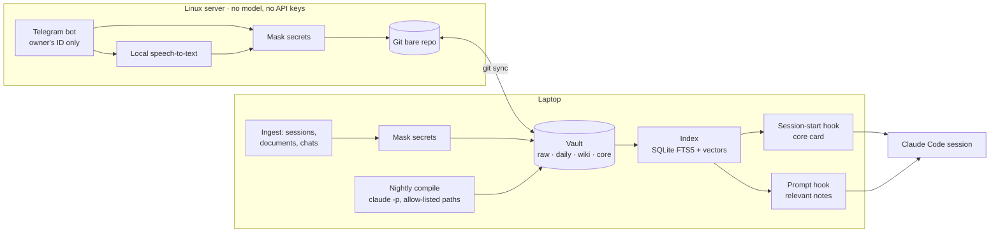

# 2ndBrain

**A personal knowledge system that gives AI coding sessions a memory — and measures whether that memory is right**

Personal project · **Designer & Developer** · [Türkçe](README.tr.md)

> **About this repository.** 2ndBrain is my own system; its code repository is private and the knowledge
> vault it manages is never part of any repository. This case study describes the architecture and the
> measurements only — no notes, names or personal data from the vault appear here.

---

## At a glance

| | |
|---|---|
| **What it is** | An Obsidian vault plus a command-line tool (`beyin`) that ingests my work and notes, searches them in Turkish, and injects the relevant facts into every Claude Code session |
| **Inputs** | Claude Code, Codex and claude.ai sessions · project documents (md, docx, pdf, pptx, xlsx) · WhatsApp exports · Telegram text and voice notes (photos are stored, not yet compiled) |
| **Outputs** | A core context card at session start, relevant notes on every prompt, a nightly compiled daily log, answers with sources |
| **Measured** | Hit@5: keyword 89.5% · vector 90.2% · **hybrid 94.7%** · prompt hook p50 / p95 = 509 / 695 ms |
| **Codebase** | ~14,500 lines of Python (standard library only) · ~1,900 lines of Node · 34 CLI commands · 318 Python + 40 Node tests · 271 commits in 12 days |

Measured from the repository and its experiment log, 17–28 Oct 2026.

---

## The problem

I work across many projects with AI agents, often in several sessions a day. Every new session starts
from zero: decisions made yesterday, rules agreed last week and the current state of each project
have to be explained again — or the agent guesses. Notes written "so the agent remembers" pile up until
nobody reads them, and a stale note is worse than none because it is confidently wrong.

I wanted the opposite: **one place where every fact has a source**, a search that works in Turkish, and
a way to put only the relevant facts in front of the agent — plus a number that says how often it is right.

## Architecture

The server never sees a model or a key: it only receives, transcribes, masks and commits. All
reasoning happens on the laptop, inside the session that needs it.

---

## Engineering decisions

### 1. Raw records are never edited; everything else can be rebuilt

Ingested material goes into `raw/` and is never changed or deleted. Daily logs, topic pages and the
core card are derived from it, so a bad summary is fixed by regenerating it — not by guessing what
the original said. Every fact on a derived page carries a link back to its raw source; a fact without
one is marked unsupported.

### 2. Deterministic work in code, judgement in the model

Folder choice, duplicate detection, masking, linting, scoring and search are plain Python. The model
is used only for synthesis — writing the nightly summary. That keeps most of the pipeline testable
(318 Python tests) and keeps token use where it adds value.

### 3. Search built for Turkish

Keyword search runs on SQLite FTS5 with a Turkish folding step (`İ → i`, `ı → i` before lowercasing,
then accents removed) and light stemming, so "toplanti" finds "toplantı" and "ILIK" finds "ılık".
BM25 weights favour titles and headings, with multipliers for folder layer, backlinks and freshness.
A local embedding model (bge-m3 via llama.cpp) adds vector search, and the two rankings are merged
with Reciprocal Rank Fusion.

| On the 189-question evaluation set | Keyword | Vector | Hybrid |
|---|---|---|---|
| Correct page in the top 5 | 89.5% | 90.2% | **94.7%** |

### 4. Saying "not in the vault" beats inventing

If the match is weak the answer is *"not enough in the vault"*, with the three nearest notes — never
a fill-in from the model's own memory. The evaluation set deliberately includes questions whose answer
is **not** in the vault, and questions built on a false premise, to measure exactly this.

### 5. Measure, then believe

A separate agent that never saw the tuning wrote the evaluation sets: 189 questions in seven categories
(single fact, multi-step, changed fact, unanswerable, big picture, no-vault-needed, central concept),
corrected over three sceptical review rounds. Every change is logged in an experiment log with the
baseline, the result and the decision. Two examples:

- Hybrid context raised "answer present in the injected context" from 68.8% to 78.3% on the tuning set;
  on an **independent** set the gain held (66.3% → 73.3%) — the check that the tuning did not overfit.
- A **volume test** grew the vault 10× and ~16× with masked filler: context accuracy fell from 89.4%
  to 83.1% — a measured, gradual decline that sets the next work item, not a surprise in production.

### 6. Privacy before anything leaves the machine

Secrets, IBANs, card numbers (Luhn-checked), Turkish ID numbers and `KEY=value` patterns are replaced
with `[GİZLİ:type]` **before** text reaches a model and before it is written to disk. Content classed
as private never enters automatic context. Injected notes are wrapped and labelled as *data, not
instructions*. A CI job — the "vault-free gate" — fails if any vault file ever appears in the code
repository.

### 7. The unattended agent can only touch what it is allowed to

The nightly compile runs `claude -p` with read/write tools only, no network and no permission bypass.
After it finishes, every change outside the allow-listed paths is copied to quarantine and reverted
with git. Changes to rules or core files land as proposals that I accept or reject.

---

## Tech stack

| Layer | Technology |
|---|---|
| Core | Python 3.9, standard library only (sqlite3 with FTS5, argparse, unittest) |
| Search | SQLite FTS5 · local embeddings (bge-m3, llama.cpp, OpenAI-compatible endpoint) · Reciprocal Rank Fusion |
| Agents | Claude Code hooks (SessionStart, UserPromptSubmit), `claude -p` for the nightly compile |
| Capture | Telegram bot in Node (no dependencies), local speech-to-text, WhatsApp / document / session importers |
| Ops | macOS launchd (nightly and periodic jobs), Docker and systemd on the server, git sync, CI gate |

## My role

I designed and built it end to end, and I use it every day: the vault structure and rules, the
ingestion and masking pipeline, Turkish search and the hybrid ranking, the Claude Code hooks, the
server side, and the evaluation sets and experiment log that decide which changes stay.

## What is not in this repository

The vault itself, any note, person, conversation or document from it, and the server details.
