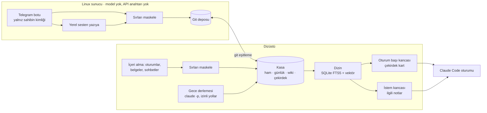

# 2ndBrain

**Yapay zekâ kodlama oturumlarına hafıza veren — ve o hafızanın doğru olup olmadığını ölçen — kişisel bilgi sistemi**

Kişisel proje · **Designer & Developer** · [English](README.md)

> **Bu depo hakkında.** 2ndBrain benim kendi sistemim; kod deposu gizli ve yönettiği bilgi kasası hiçbir
> depoya girmez. Bu vaka çalışması yalnız mimariyi ve ölçümleri anlatır — kasadan hiçbir not, kişi ya da
> kişisel veri burada yer almaz.

---

## Özet

| | |
|---|---|
| **Ne** | İşimi ve notlarımı içeri alan, Türkçe arayan ve ilgili bilgileri her Claude Code oturumuna ekleyen bir Obsidian kasası ve komut satırı aracı (`beyin`) |
| **Girdiler** | Claude Code, Codex ve claude.ai oturumları · proje belgeleri (md, docx, pdf, pptx, xlsx) · WhatsApp dışa aktarımları · Telegram metinleri ve sesli notlar (fotoğraflar saklanıyor, henüz derlenmiyor) |
| **Çıktılar** | Oturum başında çekirdek bağlam kartı, her istemde ilgili notlar, gece derlenen günlük, kaynaklı cevaplar |
| **Ölçülen** | İlk 5'te doğru sayfa: anahtar kelime %89,5 · vektör %90,2 · **karma %94,7** · istem kancası p50 / p95 = 509 / 695 ms |
| **Kod tabanı** | ~14.500 satır Python (yalnız standart kütüphane) · ~1.900 satır Node · 34 komut · 318 Python + 40 Node sınavı · 12 günde 271 commit |

Depodan ve deney defterinden ölçüldü, 17–28 Ekim 2026.

---

## Sorun

Birçok projede yapay zekâ ajanlarıyla, çoğu zaman günde birkaç oturumda çalışıyorum. Her yeni oturum
sıfırdan başlıyor: dün verilen kararlar, geçen hafta anlaşılan kurallar ve her projenin bugünkü durumu
yeniden anlatılmak zorunda — ya da ajan tahmin ediyor. "Ajan unutmasın" diye yazılan notlar kimse
okumayana kadar birikiyor; eskimiş bir not ise hiç not olmamasından kötü, çünkü kendinden emin biçimde yanlış.

Tersini istedim: **her bilginin bir kaynağı olduğu tek bir yer**, Türkçe çalışan bir arama, ajanın önüne
yalnız ilgili bilgileri koymanın bir yolu — ve ne sıklıkla doğru olduğunu söyleyen bir sayı.

## Mimari

Sunucu hiçbir modeli ya da anahtarı görmez: yalnız alır, yazıya çevirir, maskeler ve kaydeder. Bütün
akıl yürütme dizüstünde, ona ihtiyaç duyan oturumun içinde olur.

---

## Mühendislik kararları

### 1. Ham kayıt hiç değiştirilmez; geri kalan her şey yeniden üretilebilir

İçeri alınan malzeme `ham/` klasörüne girer, hiç değiştirilmez ve silinmez. Günlükler, konu sayfaları ve
çekirdek kart ondan türetilir; kötü bir özet, aslının ne dediğini tahmin ederek değil yeniden üretilerek
düzeltilir. Türetilmiş sayfadaki her bilgi ham kaynağına bağlanır; bağlantısı olmayan bilgi "desteksiz" sayılır.

### 2. Kesin işler kodda, yargı modelde

Klasör seçimi, kopya kontrolü, maskeleme, denetim, puanlama ve arama düz Python. Model yalnız sentez
için — gece özetini yazmak için — kullanılıyor. Böylece hattın çoğu sınanabilir kalıyor (318 Python
sınavı) ve token yalnız değer kattığı yerde harcanıyor.

### 3. Türkçe için kurulmuş arama

Anahtar kelime araması Türkçe katlamalı SQLite FTS5 üzerinde çalışıyor (`İ → i`, `ı → i` küçültmeden önce,
sonra aksanlar atılıyor) ve hafif kök bulma yapıyor; böylece "toplanti" "toplantı"yı, "ILIK" "ılık"ı buluyor.
BM25 ağırlıkları başlıkları ve alt başlıkları öne alıyor; klasör katmanı, geri bağlantı ve tazelik için
çarpanlar var. Yerel bir gömme modeli (llama.cpp ile bge-m3) vektör araması ekliyor ve iki sıralama
Reciprocal Rank Fusion ile birleştiriliyor.

| 189 soruluk ölçüm setinde | Anahtar kelime | Vektör | Karma |
|---|---|---|---|
| İlk 5'te doğru sayfa | %89,5 | %90,2 | **%94,7** |

### 4. "Kasada yok" demek, uydurmaktan iyidir

Eşleşme zayıfsa cevap *"kasada yeterli kayıt yok"* olur ve en yakın üç not gösterilir — modelin kendi
hafızasından tamamlama asla yapılmaz. Ölçüm seti tam bunu ölçmek için cevabı kasada **olmayan** sorular
ve yanlış öncüle dayanan sorular içeriyor.

### 5. Ölç, sonra inan

Ölçüm setlerini ayarları hiç görmemiş ayrı bir ajan yazdı: yedi kategoride 189 soru (tek olgu, çok adımlı,
değişen olgu, cevapsız, bütün resim, kasa gerektirmeyen, merkez kavram), üç şüpheci inceleme turunda
düzeltildi. Her değişiklik taban, sonuç ve kararla birlikte bir deney defterine yazılıyor. İki örnek:

- Karma bağlam, "cevap eklenen bağlamın içinde" oranını ayar setinde %68,8'den %78,3'e çıkardı;
  **bağımsız** bir sette kazanç sürdü (%66,3 → %73,3) — ayarın aşırı uyum yapmadığının kontrolü.
- Bir **hacim sınavı** kasayı maskeli dolgu metinle 10× ve ~16× büyüttü: bağlam doğruluğu %89,4'ten
  %83,1'e indi — canlıda sürpriz değil, ölçülmüş ve kademeli bir düşüş; sıradaki işi o belirliyor.

### 6. Makineden çıkmadan önce gizlilik

Sırlar, IBAN'lar, kart numaraları (Luhn denetimli), TC kimlik numaraları ve `ANAHTAR=değer` kalıpları,
metin bir modele ulaşmadan ve diske yazılmadan **önce** `[GİZLİ:tür]` ile değiştiriliyor. Gizli diye
sınıflanan içerik otomatik bağlama hiç girmiyor. Eklenen notlar *talimat değil veri* diye etiketlenip
sarılıyor. Bir CI işi — "kasasızlık kapısı" — kod deposunda tek bir kasa dosyası belirirse düşüyor.

### 7. Gözetimsiz ajan yalnız izin verilene dokunabilir

Gece derlemesi `claude -p`'yi yalnız okuma/yazma araçlarıyla, ağsız ve izin atlatmadan çalıştırıyor.
Bittiğinde izinli yolların dışındaki her değişiklik karantinaya kopyalanıp git ile geri alınıyor.
Kurallara ya da çekirdek dosyalara dokunan değişiklikler öneri olarak düşüyor; kabul ya da ret bende.

---

## Teknolojiler

| Katman | Teknoloji |
|---|---|
| Çekirdek | Python 3.9, yalnız standart kütüphane (FTS5'li sqlite3, argparse, unittest) |
| Arama | SQLite FTS5 · yerel gömme (bge-m3, llama.cpp, OpenAI uyumlu uç) · Reciprocal Rank Fusion |
| Ajanlar | Claude Code kancaları (SessionStart, UserPromptSubmit), gece derlemesi için `claude -p` |
| Yakalama | Node ile Telegram botu (bağımlılıksız), yerel sesten yazıya, WhatsApp / belge / oturum içe aktarıcıları |
| İşletim | macOS launchd (gece ve dönemsel işler), sunucuda Docker ve systemd, git eşitleme, CI kapısı |

## Rolüm

Uçtan uca tasarlayıp geliştirdim ve her gün kullanıyorum: kasa yapısı ve kuralları, içeri alma ve
maskeleme hattı, Türkçe arama ve karma sıralama, Claude Code kancaları, sunucu tarafı ve hangi
değişikliğin kalacağına karar veren ölçüm setleri ile deney defteri.

## Bu depoda olmayanlar

Kasanın kendisi, oradaki hiçbir not, kişi, konuşma ya da belge ve sunucu ayrıntıları.
